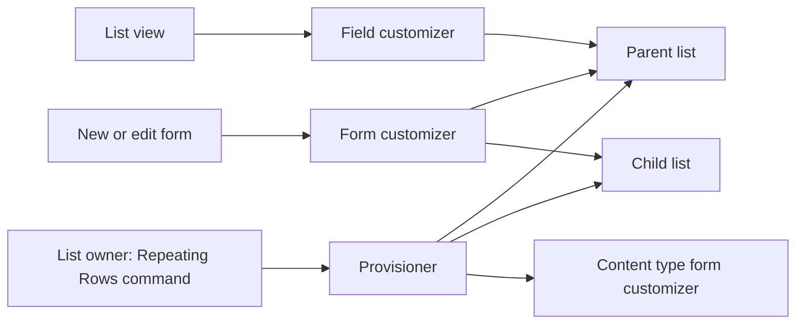
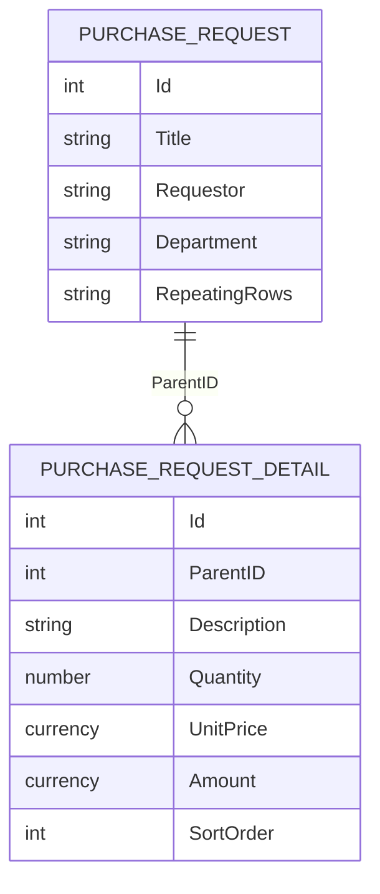

# Repeating Rows

Repeating Rows is a SharePoint Framework app for SharePoint Online. A list owner adds a **Line Items** column. People then add, edit, reorder, and delete child rows inside the item form. Each row is a normal item in a child list. The parent stores a lookup, not a JSON blob.

This is the supported alternative to a native column type. SharePoint Online does not let a client-side solution register a new field type in the **Create column** picker. That picker is a server field type (`SP.Field`). SPFx can render a field and can replace the new, edit, and display forms. It cannot add "Repeating Rows" next to Text, Choice, and Lookup.

## What you get

On a generic list, **Repeating Rows** appears on the command bar. Opening it again loads the column that is already on the list. The owner sets:

- Child list name
- Relationship field (default `ParentID`, a lookup back to the parent with cascade delete)
- Columns in a form, not JSON: display name, internal name, type, required, default, choices, lookup list, cascade, formula, and show-when
- Default values, min rows, max rows
- Allow row delete and allow row edit

Saving creates the child list with versioning, the lookup, `SortOrder`, the configured columns, and a **Line Items** text column on the parent. That text column stores only the row count so the list view can show "2 line items". It is hidden on the default forms. The list's Item content type then opens this app's form for new, edit, and display.

The form shows the parent fields SharePoint would have shown (text, note, number, currency, choice, date, yes/no, and person) and the row grid:

- Add row
- Inline edit
- Delete and duplicate
- Drag a row to reorder it
- Required and type checks before save
- Amount and other formulas update as you type
- Currency and number totals under the grid
- Lookup columns, including a cascade when `cascadeFrom` matches another column
- People picker
- Files attached to the child item
- Load more, 100 rows at a time, with windowed rendering after 40 rows

Save writes the parent item first, then creates, updates, and deletes child items and keeps `SortOrder`. Removed rows are deleted in batches of 20. New rows are created in groups of 20. Edits go through a SharePoint `$batch` changeset.

## Architecture





`ParentID` is a lookup to the parent list, indexed, with cascade delete. `SortOrder` is an indexed number. `Amount` is calculated in the form from `{Quantity}*{UnitPrice}`. Formula columns are read-only and are not written to the child list. The next time the form opens, the formula runs again from the stored inputs.

The default child list for a parent named Purchase Requests is **Purchase Requests Details**, with Description, Quantity, UnitPrice, and Amount.

## Project

```
spfx/RepeatingRows
├── config
├── sharepoint/assets
└── src
    ├── controls          grid, row editor, parent fields, setup panel
    ├── fieldCustomizers  list-view summary
    ├── formCustomizers   new, edit, and display forms
    ├── hooks
    ├── models
    ├── propertyPane      list command and configuration
    ├── repositories      parent, child, and in-memory stores
    ├── services          save, provision, people, lookups, PnP batch delete
    └── utilities         formulas, validation, save plan, batch, schema
```

| Piece | Version |
| --- | --- |
| SPFx | 1.23.2 |
| React | 17.0.1 |
| Fluent UI | `@fluentui/react-components` 9.40 |
| PnPjs | `@pnp/sp` 4.3, used to delete removed rows in batches |
| Node.js | `>=22.14.0 <23` |

SPFx 1.23.2 pins React 17. React 18 is not the supported host for this toolchain, so the app stays on React 17. Fluent UI v9.40 runs on that React version.

List reads, creates, updates, field schema, and form registration use `SPHttpClient`. PnPjs performs the child-row deletes so a removed row and its versions leave in one batched round trip per 20 items. Both stay inside the browser. There is no Azure Function and no Power App.

## Data and save

1. The form checks required parent fields and every visible child cell.
2. The parent item is created or updated. The Line Items column is set to the row count.
3. Child rows with no id are created. Rows whose values or `SortOrder` changed are merged. Ids that disappeared are deleted through PnPjs batching.
4. Files chosen on a row are uploaded to that child item after it has an id.
5. The child list has versioning on, so each update is a new version. Deleting a parent cascades to the children because the relationship is a lookup with cascade delete.

A failed child write leaves the parent in place. Open the item again and save. The form plans the difference from the rows it loaded, so a retry does not duplicate rows that were already created. Rows that were created in a failed attempt and are still on screen keep their new ids only after the create response returns; if the request fails before that, the next save creates them again.

## Scale

The grid does not render 10,000 inputs. The child query filters on the indexed parent lookup, orders by `SortOrder`, and takes 100 items. **Load more** asks for the next page with `SortOrder gt` the last value, which stays valid on large lists where `$skip` does not. After 40 loaded rows the table windows to the scroll position. Lookup choices are cached for five minutes. Creates run 20 at a time. Updates use `$batch`. Deletes use PnPjs batches of 20. Edits update the screen immediately and are written when the person clicks Save.

Ten thousand child rows for one parent are stored as ten thousand list items. SharePoint list view thresholds still apply to the child list if someone opens that list without a filter. The form query is selective. Add indexes only through this command's `ParentID` and `SortOrder` fields; do not load the child list unfiltered.

## Security

Every call runs as the current user. SharePoint trims child items the person cannot read, and a 403 or 401 is shown as a permission error. There is no app-only elevation. Row-level security is the child list's item permissions. The lookup cascade delete follows the parent's delete permission. Taxonomy, audience targeting, and unique permissions per row are not invented in the browser; use the child list's SharePoint permissions if a row must be hidden from someone.

Person columns are User fields. The picker calls the SharePoint people service and `ensureuser`, then stores the user id. A person who cannot resolve users in the site will not be able to pick one.

## What this version does not pretend to do

- It does not add a column type to the built-in Create column page. Use **Repeating Rows** on the list command bar.
- Managed metadata is a note column whose value is `Label|term-guid`. SharePoint's term picker is a server taxonomy field with a hidden note field, and provisioning that pair from SPFx is not reliable enough to call it a native metadata column.
- Formula columns are arithmetic (`+ - * /` and parentheses) over `{Column}` tokens. They are not Excel and they are not SharePoint calculated columns.
- Conditional visibility is `Field=value` on the same row.
- The parent form renders the common field types. Parent lookups, images, and taxonomy stay on the list if you need them edited outside this form, or you can add them as child columns.
- The command is registered on generic lists (template 100). Document libraries are unchanged.

## Build

From `spfx/RepeatingRows`:

```bash
npm install
npm test
npm run build
```

The package is `sharepoint/solution/repeating-rows.sppkg`. Copy it to `deploy/repeating-rows.sppkg` after a release build. `npm start` serves the workbench on port 4327.

## Deploy

1. Upload `repeating-rows.sppkg` to the tenant app catalog and deploy it. This is a full-trust client-side solution in the same way other SPFx packages are: it asks for no extra Microsoft Graph permission. It uses the current user's SharePoint access.
2. On the site, open **Site contents → Add an app → From your organization → Repeating Rows**.
3. Open the parent list, for example Purchase Requests. Choose **Repeating Rows**.
4. Set the child list name to Purchase Request Details. Leave the relationship field as ParentID. The form already lists Description, Quantity, Unit Price, and Amount. Add or change columns there. Set min and max rows if you need them. Click **Create column**. Opening **Repeating Rows** again loads these settings so you can change them.
5. Add **Requestor** and **Department** as normal SharePoint columns if they are not there yet. The form picks them up because they are ordinary fields.
6. Choose **New**. The line-item grid is the form. Save. The view shows the row count in **Line Items**. Edit the item to change, reorder, or remove rows.

To upgrade, package a higher version in `config/package-solution.json`, upload the new `.sppkg` over the catalog entry, and accept the update on each site when SharePoint offers it. Re-run **Repeating Rows** only when the column definition itself must change. Existing child items stay in the child list.

Uninstalling the app removes the command. It does not delete the child list or the items. Remove those from Site contents if you want them gone.

## Governance

- Deploy from the app catalog. Do not turn on custom script for this package (`requiresCustomScript` is false).
- A site owner adds the app. A list owner runs the command. People who can edit the parent can edit rows only when they can also edit the child list.
- The form customizer is attached to that list's Item content type, not to every list in the tenant.
- The Line Items value is a count. Do not build a flow that expects JSON in that column.
- Child lists should inherit the parent's audience or be locked down on purpose. Cascade delete will remove children when the parent is deleted.
- Keep one child list per repeating column. A second configuration on the same parent needs a different child list and a different marker field; this version uses the internal name `RepeatingRows` once per list.

## Compared with KWizCom Repeating Rows

KWizCom is a shipped product with a long configuration UI, more field types, and support you can buy. It is also a third-party dependency, a license, and a package you do not control.

This app keeps every row as a list item you can report on, secure, and version with the tools you already have. It runs only in SharePoint Online. It does not add the column to the native type picker, its formula language is small, and managed metadata is a label plus a guid rather than the term store picker. Those gaps are the Microsoft platform limits called out above, plus the scope of this solution. If you need a vendor-supported repeating-row designer, KWizCom still covers more of that surface. If you need the data in a child list without another vendor, this package is the path that stays inside Microsoft 365.
